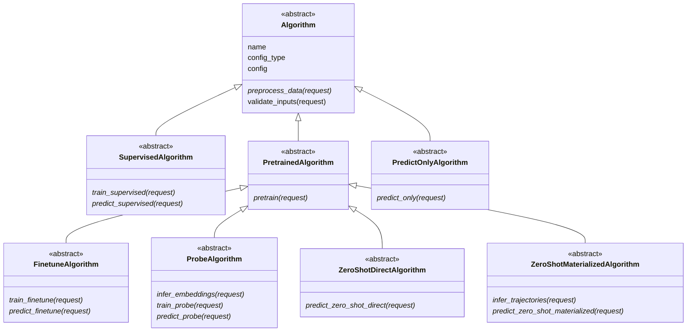
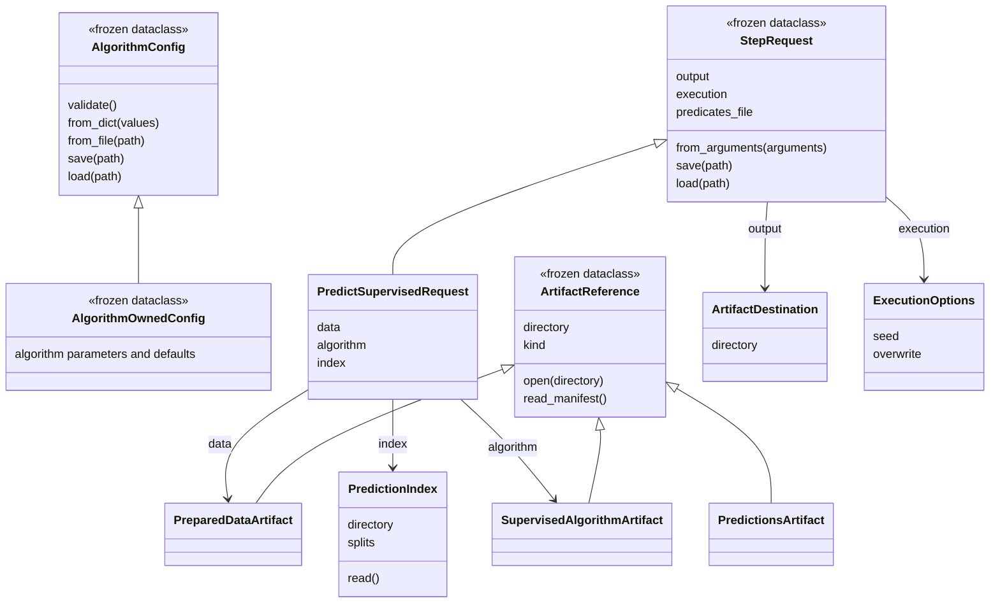
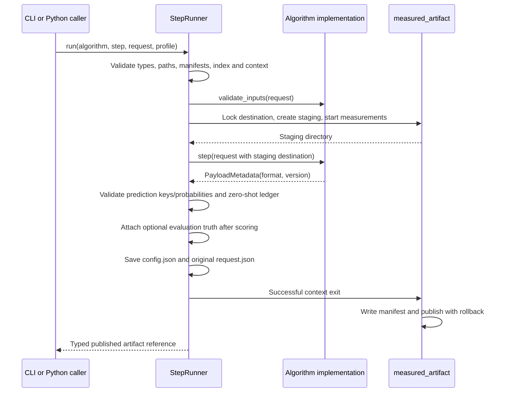

# Architecture and typed algorithm API

Core owns profile interfaces, typed requests, artifact references, serialization and execution.
Algorithm repositories own concrete algorithms, configurations, payloads and scientific compatibility.
The [contract](src/meds_algorithm_core/CONTRACT.md) remains normative. These diagrams describe implemented
classes. This source is also packaged in the wheel and rendered by the template documentation.

## Profile hierarchy

Every profile requires preprocessing; only pretrained profiles require pretraining. A family can
inherit several profile ABCs when shared methods have the same semantics, or register separate
implementation classes that share internal components.



Each profile class declares its `profile` and ordered `steps`; method annotations identify request
types. Request fields define CLI arguments, while each request declares its output argument and
result artifact class. There is no independent step-definition registry. `ALGORITHM_PROFILES` and
`STEP_SPECS` are read-only, derived compatibility views for existing consumers.

## Requests, configuration and artifacts



Artifact constructors normalize paths without loading payloads. `open`/`read_manifest` validate the
common envelope and artifact type. The runner validates references before algorithm code. Payload readers
remain algorithm-owned; core imposes no tensor, tokenizer, batching or dataframe representation.

`TrainingLabels.read` accepts only train/tuning. `PredictionIndex.read` projects keys at the I/O boundary.
`PredictionContext` explicitly selects train/tuning and checks overlap with evaluated keys. Zero-shot
requests carry `TaskSpec`. These interfaces make permissions clear; they are not a filesystem sandbox.

Define configuration in the algorithm repository:

```python
from dataclasses import dataclass
from meds_algorithm_core import AlgorithmConfig


@dataclass(frozen=True)
class Config(AlgorithmConfig):
    C: float = 1.0
    max_iterations: int = 1000

    def validate(self):
        if self.C <= 0 or self.max_iterations < 1:
            raise ValueError("C and max_iterations must be positive")
```

Core validates field types, rejects unknown keys and nonfinite floats, and resolves defaults. Supported
values are strings, booleans, integers, finite floats, paths, enums, tuples, optional values and nested
frozen dataclasses. Mutable configuration fields and arbitrary Python objects are unsupported. JSON
arrays can initialize typed tuples. Override `validate`, not `__post_init__`, for algorithm constraints.

Use `config_file=/path/config.yaml` on the CLI for a JSON/YAML values mapping. Relative paths in that
file resolve against its parent. `Config.save` writes a versioned JSON envelope with an explicit class
identifier and all resolved values. `Config.load` checks the requested class and schema version; it
never imports code named by a file. Increment the algorithm's `schema_version` when serialized meaning
changes; unsupported versions fail without guessing migrations. Requests use the same serialization.
Constructed references use absolute paths; moving artifacts requires explicitly updating locations.

## Shared execution

`AlgorithmRepository` associates profile names with implementation classes, creates a fresh instance
for every dispatch, converts CLI arguments into a request, and delegates to `StepRunner.run`. Python
callers can invoke the runner directly.



Algorithm methods write payloads only into `request.output.directory` and return `PayloadMetadata`. They
must not write the reserved `manifest.yaml`, `config.json` or `request.json`, or publish final directories.
Directly calling algorithm methods bypasses runner validation/publication; production and test adapters
must use the runner. Low-level publication helpers remain available for legacy implementations.

Prediction payloads are Parquet shards with keys and probabilities, without ground truth. The runner
validates their combined key set and probabilities, then optionally attaches evaluation labels. That
label path is a runner-only argument, never part of the algorithm's prediction request. Install the `data`
extra for typed prediction execution. Zero-shot outputs include `relaxations.yaml` at their root.

Outputs must not overlap inputs. Failures before publication preserve the previous published artifact;
filesystem/crash limitations remain as described in the README. The measured interval includes algorithm
execution and postprocessing/publication preparation, not initial input validation. Algorithms apply
`request.execution.seed` to relevant RNGs and subprocesses; core does not seed frameworks implicitly.

The default `Algorithm.validate_inputs` requires fitted-algorithm inputs to record the same algorithm name
and resolved configuration. Extend it for vocabulary, shape, payload-format and scientific checks.
Override that default deliberately for a documented policy, such as compatible external pretrained
algorithms. Reopen persisted artifacts; prediction must not depend on training on the same object.

Each successful artifact includes resolved configuration and original request, implementation identity,
explicit algorithm-checkout provenance, upstream manifest digests and a key-only index digest. Manifest
digests identify envelopes, not every payload byte. Dataset revisions and algorithm-specific content
identities remain algorithm/run responsibilities; serialization does not make external data immutable.
Replaying evaluation additionally requires the runner-only label path recorded in the manifest.

## Ownership and compatibility

| Location | Owns |
|---|---|
| Core | Profile ABCs, request/artifact types, serialization, runner, shared validation and conformance |
| Template | Algorithm/config stubs, CLI, profile YAML, test adapters and operational files |
| Algorithm repository | Concrete typed config, algorithms/components, payload formats, compatibility and scientific tests |

Legacy `Command`/`LegacyAlgorithmRepository` retain their previous mapping-based behavior. They do not acquire
the runner's stronger validation/publication automatically. New generated repositories use
`AlgorithmRepository`. Contract version 4 uses algorithm-named package imports, CLI entry points,
artifact types and input/output arguments. Version 3 artifacts and serialized types are not accepted
under the new names by changing a version field. Existing repositories require an explicit migration.
