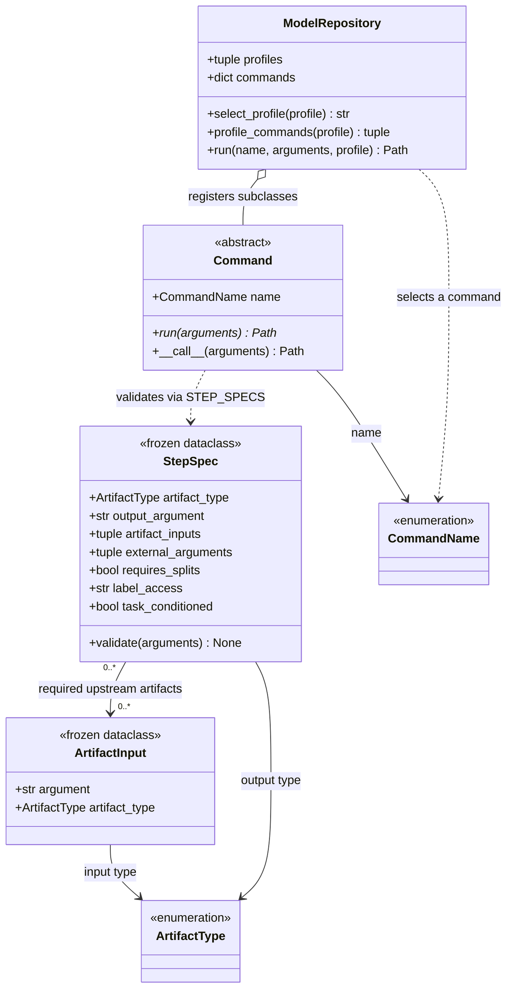
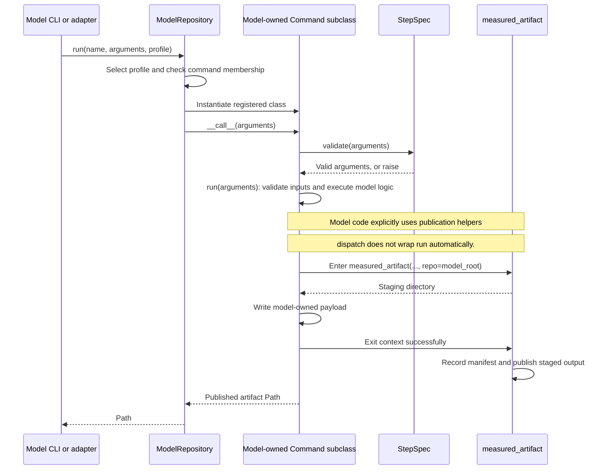
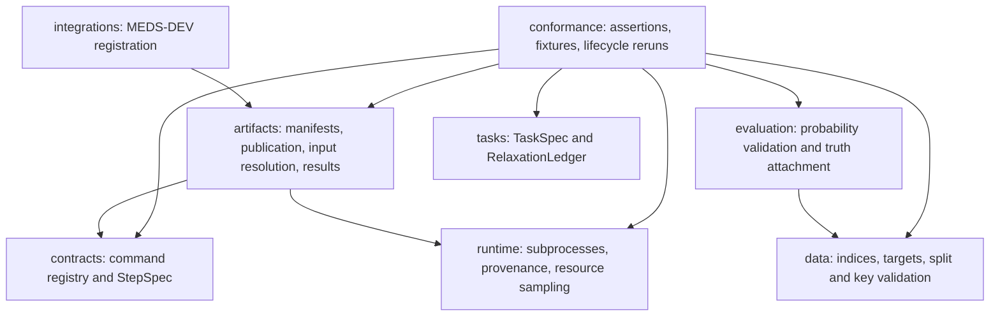

# Architecture

`meds-model-core` supplies command boundaries and shared infrastructure. A model repository supplies
the implementations and selects its profiles. This page describes the implemented API; the final
section discusses possible extensions. [CONTRACT.md](src/meds_model_core/CONTRACT.md) remains the
normative specification.

## Current command classes

These classes are implemented in [contracts/commands.py](src/meds_model_core/contracts/commands.py).
The UML omits enum members and shortens Python type expressions for readability. Dashed arrows denote
dependencies; the open diamond denotes a reference to registered classes, not ownership of a fitted model.

Two module-level dictionaries connect these classes:

- `MODEL_PROFILES` maps a profile name to its ordered command names. `ModelRepository` requires the
  registered classes to cover exactly the union of the selected profiles.
- `STEP_SPECS` maps each command name to its `StepSpec`: required path arguments, input/output artifact
  types, split requirements, label-access policy and whether it receives task criteria.

There is **one abstract command interface**, `Command.run(arguments: Mapping[str, Any]) -> Path`.
`PreprocessData`, `TrainSupervised`, `PredictSupervised` and the other named step classes are generated
in model repositories; they are not separate abstract classes exported by core. The template initially
derives them from a model-local `StubCommand`, whose `run` raises `NotImplementedError`.

`StepSpec.validate` checks argument shapes and rejects certain forbidden arguments. It does not open
and validate every upstream artifact, enforce which files model code reads, or validate predictions.
Implementations must invoke the appropriate core helpers and perform model-specific compatibility
checks. Conformance tests provide additional evidence; Python inheritance does not enforce scientific
correctness or data isolation.

## How a command executes

This is a successful execution using the publication helper. Computation can occur before or inside
the context; work outside it is not included in its measurements. On failure inside the context,
publication does not produce a new successful artifact.

Each dispatch constructs a new command instance. Steps can run in separate processes or SLURM jobs;
persisted artifacts carry their state between invocations. `ModelRepository` dispatches one command
at a time, not an entire lifecycle. Model CLI adapters, MEDS-DEV descriptors and execution scripts
arrange the ordered calls.

## Shared modules and supporting types

Most supporting APIs are functions, not classes. The dependency diagram below shows selected internal
dependencies, not a pipeline order or an exhaustive import graph.

| Implemented type | Responsibility | Used by |
|---|---|---|
| [`TaskSpec`](src/meds_model_core/tasks/spec.py) | Frozen dataclass holding ACES criteria, optional predicates and task name; computes a semantics digest and provenance. | Model-owned task-conditioned prediction code. |
| [`RelaxationLedger`](src/meds_model_core/tasks/spec.py) | Frozen dataclass holding query language, decoded quantity, exactness and rewrite/assumption steps; reads/writes `relaxations.yaml`. | Zero-shot implementations and conformance checks. |
| [`E2EResult`](src/meds_model_core/conformance/types.py) | Frozen dataclass holding artifact paths, the evaluation index location (`labels_dir`), splits, external inputs/seed and canaries. | Model-local `run_e2e` adapters and shared lifecycle checks. |
| [`MEDSDevRun`](src/meds_model_core/conformance/types.py) | Frozen dataclass holding invocation arguments, predictions location, evaluation index location and splits. | Model-local MEDS-DEV test adapters. |
| [`_ProcessTreeMemorySampler`](src/meds_model_core/runtime/resources.py) | Private implementation of sampled memory measurements. | `measured_artifact`; not a model extension interface. |

There is no core `Artifact`, fitted `Model`, or `Algorithm` superclass. Artifact payloads are model-owned
files, manifests are mappings, and command results are paths. The contract's example `Preprocessor`,
`FrozenEncoder`, `TaskTrainer`, `TaskPredictor` and `TrajectoryGenerator` are recommended internal
responsibilities, not implemented core ABCs.

## Should there be an Algorithm superclass and separate step interfaces?

Separate interfaces for supported operations would be a useful extension. The current generic
`Mapping[str, Any]` boundary makes dispatch uniform, but gives implementers limited type checking and
editor guidance. Metadata validation cannot replace explicit, typed method signatures.

A mandatory `Algorithm` superclass with every lifecycle method would require models to expose
operations they do not support: a supervised model has no trajectory generator, a probe predictor
consumes existing embeddings, and a predict-only model has no persistent training step. Multiple
profiles also share some implementations without sharing every operation. A base class with only
common metadata is possible, but by itself would add little to the existing repository registry.

A more useful design would be an **algorithm object that composes narrow capability interfaces**:
preprocessing, supervised training, supervised prediction, embedding inference, trajectory inference,
and the other distinct steps. A model family would supply only its supported capabilities, and profiles
would select the required combinations. Such an object could provide a convenient Python entry point
while existing command adapters retain the artifact-based CLI and process boundaries.

That design need not require a single long-lived instance or in-memory fitted state. Each capability
can load its inputs from artifacts and publish its output, so separate jobs and external executables
remain supported. An ABC can require an implementation; a `Protocol` can describe a compatible object
without forcing existing model classes into a new inheritance hierarchy.

Before adding this API, define the responsibilities of the algorithm object and typed arguments/results
for each operation. Keep command names, required paths, profile composition and artifact policies in
one authoritative schema so interfaces do not become a second, inconsistent specification. Label-free
prediction and training/context inputs should remain separate in those types. Preserve existing
`Command` adapters during migration and prove the design against both a simple supervised model and a
family with several profiles.

**Recommendation:** add typed step interfaces when implementing that API improvement; make an
`Algorithm` facade optional and based on composition. This document adds no new runtime API and does
not claim these proposed interfaces already exist.
