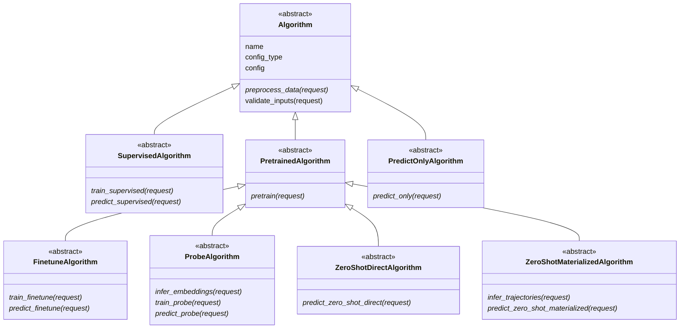
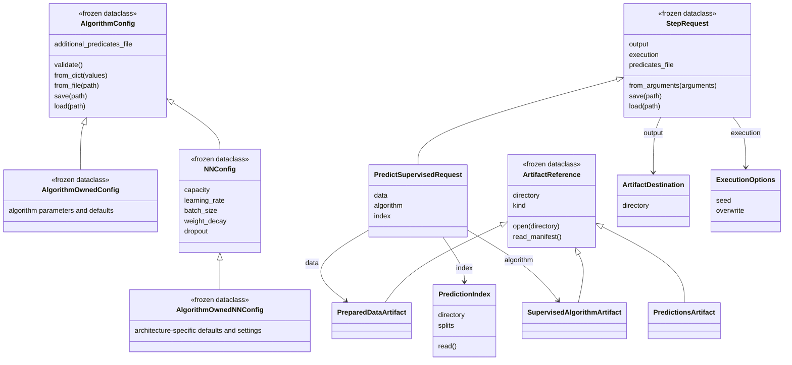
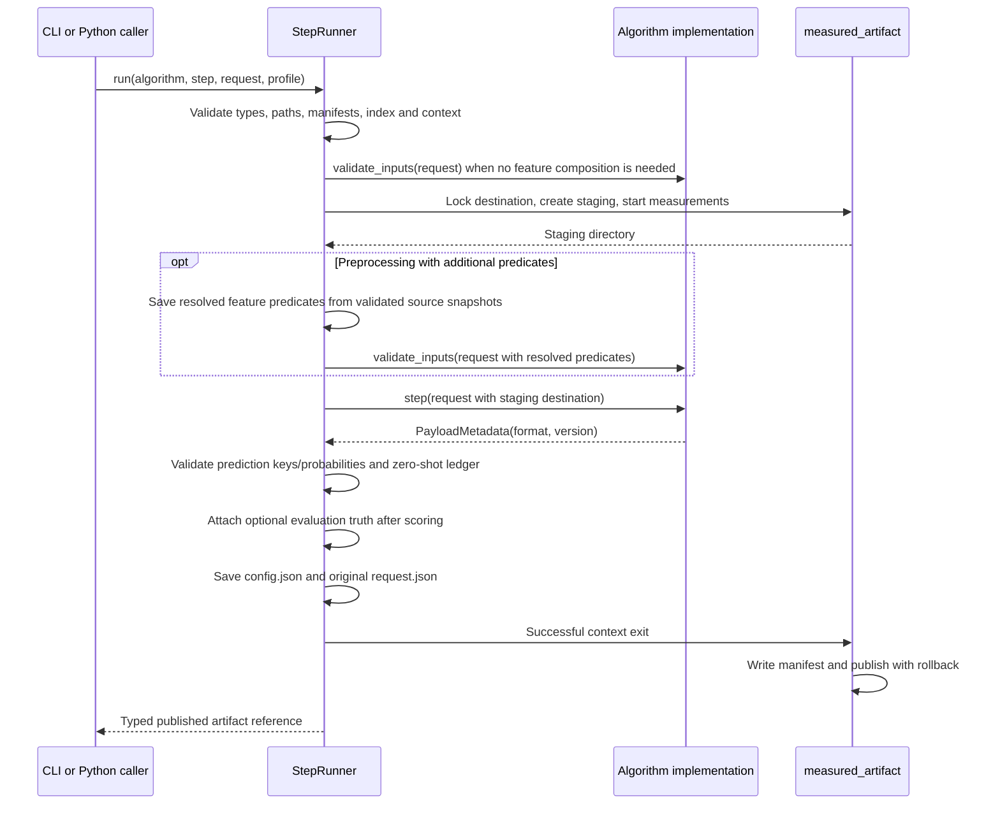

# Architecture and typed algorithm API

Core owns profile interfaces, typed requests, artifact references, serialization and execution.
Algorithm repositories own concrete algorithms, configurations, payloads and scientific compatibility.
The [contract](src/meds_algorithm/CONTRACT.md) remains normative. These diagrams describe implemented
classes. This source is also packaged in the wheel and rendered by the template documentation.

## Profile hierarchy

Every profile requires preprocessing; only pretrained profiles require pretraining. A family can
inherit several profile ABCs when shared methods have the same semantics, or register separate
implementation classes that share internal components.



Each profile class declares its `profile` and ordered `steps`; method annotations identify request
types. Request fields define CLI arguments, while each request declares its output argument and
result artifact class. There is no independent step-definition registry. `ALGORITHM_PROFILES` and
`STEP_SPECS` are read-only, derived compatibility views for existing consumers.

## Requests, configuration and artifacts



Artifact constructors normalize paths without loading payloads. `open`/`read_manifest` validate the
common envelope and artifact type. The runner validates references before algorithm code. Payload readers
remain algorithm-owned; core imposes no tensor, tokenizer, batching or dataframe representation.

`TrainingLabels.read` accepts only train/tuning. `PredictionIndex.read` projects keys at the I/O boundary.
`PredictionContext` explicitly selects train/tuning and checks overlap with evaluated keys. Zero-shot
requests carry `TaskSpec`. These interfaces make permissions clear; they are not a filesystem sandbox.

Define configuration in the algorithm repository:

```python
from dataclasses import dataclass
from meds_algorithm import AlgorithmConfig


@dataclass(frozen=True)
class Config(AlgorithmConfig):
    C: float = 1.0
    max_iterations: int = 1000

    def validate(self):
        if self.C <= 0 or self.max_iterations < 1:
            raise ValueError("C and max_iterations must be positive")
```

Core validates field types, rejects unknown keys and nonfinite floats, and resolves defaults. Supported
values are strings, booleans, integers, finite floats, paths, enums, tuples, optional values and nested
frozen dataclasses. Mutable configuration fields and arbitrary Python objects are unsupported. JSON
arrays can initialize typed tuples. Override `validate`, not `__post_init__`, for algorithm constraints.

Use `config_file=/path/config.yaml` on the CLI for a JSON/YAML values mapping. Relative paths in that
file resolve against its parent. `Config.save` writes a versioned JSON envelope with an explicit class
identifier and all resolved values. `Config.load` checks the requested class and schema version; it
never imports code named by a file. Increment the algorithm's `schema_version` when serialized meaning
changes; unsupported versions fail without guessing migrations. Requests use the same serialization.
Constructed references use absolute paths; moving artifacts requires explicitly updating locations.

`additional_predicates_file` is an optional keyword-only configuration field inherited by concrete
configs. Preprocessing alone composes it with dataset predicates, rejects duplicate names/keys, and
supplies a resolved `request.predicates_file` to the hook and method. The runner preserves that file
inside prepared data with source/resolved digests; its contents are reserved. Later stages do not read
the additions, and `TaskSpec` continues to use the original task binding. See contract section 2.3.

## Neural-network configuration and scaling experiments

`AlgorithmConfig` is the common parent. `NNConfig` is an optional, framework-independent child for
neural algorithms whose settings have the semantics below. It provides validation and serialization,
not a neural network, optimizer or training loop. Classical algorithms continue to extend
`AlgorithmConfig` directly.

| Setting | Meaning and validation |
|---|---|
| `capacity` | Positive finite multiplier relative to the algorithm's reference architecture; defaults to `1.0` |
| `learning_rate` | Positive finite base optimizer learning rate, before scheduling |
| `batch_size` | Positive integer examples per device per microbatch, before gradient accumulation |
| `weight_decay` | Nonnegative finite weight-decay coefficient; defaults to zero |
| `dropout` | Finite probability of dropping a unit, in `[0, 1)`; defaults to zero |

Core deliberately supplies no default learning rate or batch size. A concrete algorithm defines its
reference architecture and multiplier-to-dimensions mapping, supplies source-defined defaults, chooses
its optimizer and scheduler, and specifies which parameter
groups receive weight decay and where dropout is applied. Do not treat weight decay as an interchangeable
L2 loss penalty or dropout as a keep probability. If an architecture has several widths or dropout rates,
declare their meaning and additional typed fields locally; do not silently ignore inherited settings.
For a neural algorithm without meaningful capacity scaling or microbatch semantics, use `AlgorithmConfig`
with explicit local fields instead of inventing a mapping just to satisfy this optional interface.

For example, a transformer can scale its hidden dimension while keeping depth fixed. This illustrative
policy rounds down to a multiple of attention heads, with at least one dimension per head. The reference
width must already be divisible by the head count, so `capacity=1.0` preserves the reference architecture.
Other algorithms may scale depth, several dimensions, or target parameter counts; document and test the
exact mapping and rounding. `capacity=2.0` does **not** universally mean twice the parameters or FLOPs.

```python
from dataclasses import dataclass, replace
from meds_algorithm import NNConfig


@dataclass(frozen=True)
class TransformerConfig(NNConfig):
    learning_rate: float = 0.001
    batch_size: int = 32
    weight_decay: float = 0.01
    dropout: float = 0.1
    reference_width: int = 128
    depth: int = 4
    heads: int = 4

    @property
    def hidden_size(self) -> int:
        return max(1, int(self.reference_width * self.capacity / self.heads)) * self.heads

    def validate(self):
        super().validate()
        if self.heads < 1 or self.reference_width < 1 or self.reference_width % self.heads:
            raise ValueError("reference_width must be positive and divisible by positive heads")
        if self.depth < 1:
            raise ValueError("depth must be positive")


config = TransformerConfig()
larger = replace(config, capacity=2.0)
assert larger.hidden_size == 256
larger.save("config.json")
assert TransformerConfig.load("config.json") == larger
```

Override `validate()` with `super().validate()` when adding constraints to `NNConfig`.
Set the implementation's `config_type = TransformerConfig` and export the named config from its package.
The existing runner records every resolved field in `config.json` and the manifest. YAML uses the same
names; `lr` and `bs` aliases are intentionally not accepted:

```yaml
capacity: 2.0
reference_width: 128
depth: 4
heads: 4
learning_rate: 0.001
batch_size: 32
weight_decay: 0.01
dropout: 0.1
```

The capacity multiplier is an experimental input, not a comparable measured parameter count. For scaling-law
analysis, an implementation should separately report total and trainable parameters of the instantiated
network, resolved architecture dimensions, actual optimizer steps, consumed examples/events/tokens (with
units), and effective batch size. Record resolved dimensions in an algorithm-owned payload/report as well
as retaining the multiplier, reference settings and implementation revision in existing core provenance.
For fixed-size full microbatches, effective batch size is `batch_size × gradient_accumulation_steps ×
world_size`; uneven batches or dynamic token batching require actual measurements. Any accumulation,
distributed or token-budget settings belong in the concrete config. Core does not infer these quantities,
instantiate optimizers or enforce that an implementation uses a field; algorithm tests must verify the
mapping. There is no automatic scaling-law experiment runner or standardized scaling-results artifact yet.

### Data scaling belongs to experiment orchestration

Recommended ownership is upstream: MEDS-DEV or another experiment runner selects the training cohort
and materializes or references an explicit subset before calling algorithms. This is an integration
recommendation, not a claim that MEDS-DEV already implements that sampler. No `data_fraction` field or
hidden sampler is added to `NNConfig`.

- Fix the split assignment first. Select **training subjects**, retaining their valid history, rather than
  sampling arbitrary event rows. Keep tuning and evaluation keys fixed across a data-scaling sweep.
- Use deterministic nested subsets with a recorded selection seed and explicit membership digest/list.
  Reuse the same subject membership across algorithms; a fraction and seed alone are not an identity.
- Record dataset revision, eligible and selected subjects/events, selection rule and temporal cutoffs
  upstream. Scope learned preprocessing and label bundles consistently to the selected training cohort.
  For pretraining versus fine-tuning, declare separately which population is being scaled.
- Let the algorithm report what was actually consumed after filtering/tokenization, plus repetitions and
  training budget. Dataset size, unique token count and total tokens processed are different quantities;
  choose whether a sweep fixes steps, epochs or compute and record that decision.

These cohort-selection and consumption-reporting integrations remain future work. The implemented shared
interface covers configuration and its existing persisted provenance; it does not perform data selection
or count network parameters. Avoid adding another dataset-selection configuration until its upstream
owner and identity format are agreed.

## Shared execution

`AlgorithmRepository` associates profile names with implementation classes, creates a fresh instance
for every dispatch, converts CLI arguments into a request, and delegates to `StepRunner.run`. Python
callers can invoke the runner directly.



Algorithm methods write payloads only into `request.output.directory` and return `PayloadMetadata`. They
must not write the reserved `manifest.yaml`, `config.json` or `request.json`, or publish final directories.
Directly calling algorithm methods bypasses runner validation/publication; production and test adapters
must use the runner. Low-level publication helpers remain available for legacy implementations.

Prediction payloads are Parquet shards with keys and probabilities, without ground truth. The runner
validates their combined key set and probabilities, then optionally attaches evaluation labels. That
label path is a runner-only argument, never part of the algorithm's prediction request. Install the `data`
extra for typed prediction execution. Zero-shot outputs include `relaxations.yaml` at their root.

Outputs must not overlap inputs. Failures before publication preserve the previous published artifact;
filesystem/crash limitations remain as described in the README. The measured interval includes algorithm
execution and postprocessing/publication preparation, not initial input validation. Algorithms apply
`request.execution.seed` to relevant RNGs and subprocesses; core does not seed frameworks implicitly.

The default `Algorithm.validate_inputs` requires fitted-algorithm inputs to record the same algorithm name
and resolved configuration. Extend it for vocabulary, shape, payload-format and scientific checks.
Override that default deliberately for a documented policy, such as compatible external pretrained
algorithms. Reopen persisted artifacts; prediction must not depend on training on the same object.

Each successful artifact includes resolved configuration and original request, implementation identity,
explicit algorithm-checkout provenance, upstream manifest digests and a key-only index digest. Manifest
digests identify envelopes, not every payload byte. Dataset revisions and algorithm-specific content
identities remain algorithm/run responsibilities; serialization does not make external data immutable.
Replaying evaluation additionally requires the runner-only label path recorded in the manifest.

## Ownership and compatibility

| Location | Owns |
|---|---|
| Core | Profile ABCs, request/artifact types, serialization, runner, shared validation and conformance |
| Template | Algorithm/config stubs, CLI, profile YAML, test adapters and operational files |
| Algorithm repository | Concrete typed config, algorithms/components, payload formats, compatibility and scientific tests |

Legacy `Command`/`LegacyAlgorithmRepository` retain their previous mapping-based behavior. They do not acquire
the runner's stronger validation/publication automatically. New generated repositories use
`AlgorithmRepository`. Contract version 4 uses algorithm-named package imports, CLI entry points,
artifact types and input/output arguments. Version 3 artifacts and serialized types are not accepted
under the new names by changing a version field. Existing repositories require an explicit migration.
