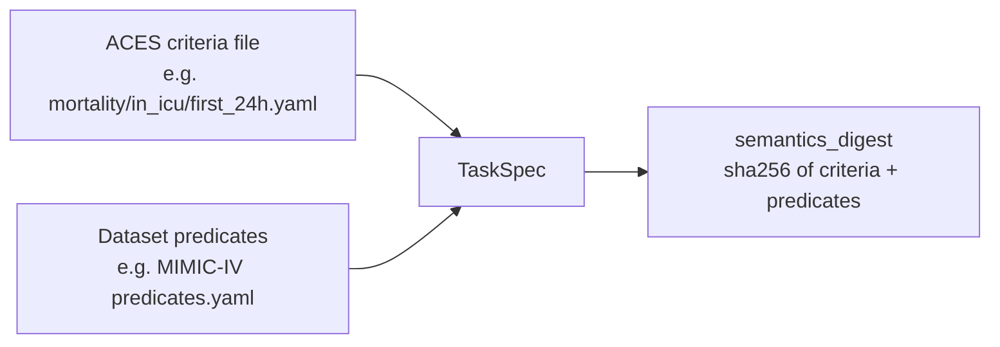
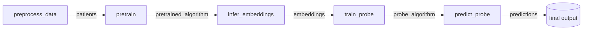

# Concepts

This page walks through the objects the contract talks about, in the order data flows through an algorithm:
the dataset, the task, the predicates, the task specification (zero-shot only), the artifacts each
command publishes, the final predictions, and the measurements attached to all of them.

## The MEDS dataset and its splits

The input data is a split-sharded [MEDS](https://medical-event-data-standard.github.io/) dataset, passed
as `external_meds_dir`. MEDS fixes what `subject_id`, `time`, `code`, the value columns, static events
(`time = null`) and code metadata mean; an algorithm may not reinterpret them.

The dataset comes with three splits: `train`, `tuning` and `held_out`. They are a **boundary**:

!!! warning "Fit population statistics on `train` only"
    Anything fitted over a population — vocabularies, code frequencies, quantile bins, normalization
    constants, feature selections — must be fitted on the training split alone. Fitting over all splits is
    *transductive leakage*. It is easy to miss because it is not label leakage: code frequencies do not
    depend on labels, so an algorithm can pass every label-leakage check and still carry it. If preprocessing
    is delegated upstream and the scope is not yours to control, declare which quantity was fitted over
    which population.

The generated end-to-end test checks this: it plants a canary code in every tuning and held-out subject of
its fixture, and none may appear among the codes the algorithm fitted statistics for (see the
[FAQ](faq.md#how-do-the-tests-catch-label-leakage-and-transductive-fitting)).

The MIMIC-IV demo in MEDS form is the canonical real-data example used by the tests; it is not a separate
schema.

## The task index (built upstream)

An upstream task extraction can store both keys and outcomes. Inference/scoring receives its key-only
view as `external_index_dir`; training receives permitted targets through `external_labels_dir`:

- **keys**: `(subject_id, prediction_time)`, the rows to predict, in every split;
- **labels**: a value column such as `boolean_value`.

### Who reads which labels

Keys identify where to predict; ground-truth values describe what happened. They are not interchangeable.
The [canonical argument table](reference/spec.md#step-arguments-and-artifacts) defines each step's access.
Inference and ordinary scoring read only keys. The core index reader projects those columns at Parquet
read time, even when MEDS-DEV supplies a directory whose files also contain outcomes.

The index is never built in the algorithm repository. One ACES extraction, run upstream, applies the task's
trigger, inclusion/exclusion criteria and splits, so every algorithm scores exactly the same rows:

| Run | Who builds the index |
|---|---|
| MIMIC-IV demo (smoke test) | MEDS-DEV's `meds-dev-task`, task `mortality/in_icu/first_24h` |
| Full-data evaluation | a shared, reviewed task bundle for the target dataset, built once upstream: clinical tasks defined and extracted with [ACES](https://eventstreamaces.readthedocs.io/), or randomly sampled code-by-horizon tasks (generated with [meds-random-task-sampler](https://github.com/florian6973/meds-random-task-sampler) and selected with [meds-task-selection](https://github.com/florian6973/meds-task-selection)), containing each task's definition and its per-task index and labels |

Every algorithm compared on a dataset uses the same bundle. Zero-shot runs additionally need each task's ACES
criteria file.

An algorithm repository must not re-extract, filter or extend the index. If an algorithm rebuilt the cohort itself,
two algorithms could silently be evaluated on different patients, and a zero-shot algorithm would read the labels
it is supposed to be blind to.

### Reading labels: the one rule

The contract rule is: evaluated-split labels are never read, and only `train_supervised` / `train_finetune` / `train_probe`
and a `predict_only` in-context learner read train/tuning labels. There is exactly one sanctioned exception: once every probability is final, `predict` may join the label column onto the predictions by
key (`attach_ground_truth`), because meds-evaluation reads ground truth from the predictions file. Nothing
computed from that join may feed back into a prediction.

## Dataset predicates

Tasks are written against named *predicates* (for example `icu_admission`, `death`, or
`abnormally_low_sodium` with a value threshold). A dataset's predicates file binds those names to that
dataset's codes. It is passed as `external_predicates_file` (MEDS-DEV's `{predicates_path}`).

- When MEDS-DEV provides predicates for a dataset, reuse them; the MIMIC-IV demo must use MEDS-DEV's
  MIMIC-IV predicates.
- The algorithm decides whether and how to use them: selecting tokens, building SQL or columns, matching
  events directly, or not at all.
- Any command that consumes the file records its digest and origin in its manifest.
- An algorithm that relies on particular predicate names declares and validates them in its own configuration.
  The contract deliberately has no generic "predicate features" format.

### Additional feature predicates per dataset

Every generated configuration inherits optional `additional_predicates_file` from `AlgorithmConfig`.
Select the dataset configuration explicitly, for example `config_file=/repo/dataset_configs/mimic_iv.yaml`:

```yaml
additional_predicates_file: ../predicates/mimic_iv_additional.yaml
```

Paths resolve relative to the configuration file. The additional file has the same predicate-only
shape as MEDS-DEV's dataset file:

```yaml
predicates:
  algorithm_specific_event:
    code: YOUR_DATASET_EVENT_CODE
```

During `preprocess_data`, core combines this file with `external_predicates_file`, or uses it alone if
no base was supplied. Duplicate names are errors even if their definitions agree; duplicate YAML keys
and task/cohort sections are also rejected. Expression semantics and dataset compatibility remain the
algorithm's responsibility. The runner passes the resolved path as `request.predicates_file` to both
the compatibility hook and preprocessing. Implementations must read that path rather than merge files.

Core saves `resolved_feature_predicates.yaml` in the prepared-data artifact, records both source paths
and content digests plus the resolved digest, and includes them in the configuration digest. The source
additions file can be temporary: later steps use persisted features and do not reopen or merge it.
Keep the same configuration across the lifecycle; use a separate config file for each dataset.

These are feature additions only. They never modify `TaskSpec`, evaluated labels, or the cohort. Task
predicates continue to reach only the task-conditioned commands through the original task binding.
Preprocessing must not include outcome-dependent definitions or read events beyond each permitted cutoff.
For a changed target or cohort, update the shared upstream task bundle instead.

## The task specification (zero-shot only)

A supervised algorithm learns *what* to predict from labels. A zero-shot algorithm never sees labels, so the task
itself must be an input. The task language is [ACES](https://eventstreamaces.readthedocs.io/): a criteria
file passed as `external_task_criteria_file`, bound to the dataset predicates. The pair is the **task
specification** (`TaskSpec`).



The **semantics digest** hashes the criteria bytes together with the predicates bytes. MEDS-DEV task files
leave dataset codes as `???`, so the same criteria bound to MIMIC-IV and to eICU predicates are different
tasks with different digests. Every task-conditioned artifact records this digest, so an artifact can never
be silently reused for another task. See [Zero-shot in practice](zero-shot.md).

## Artifacts and the manifest envelope

Every command publishes one **artifact**: a directory containing whatever payload the algorithm wants plus a
`manifest.yaml` that follows a fixed envelope.



*(The `probe` profile shown; other profiles skip some commands. See [Choosing a profile](profiles.md).)*

| Artifact type | Produced by | Meaning |
|---|---|---|
| `patients` | `preprocess_data` | the algorithm's own representation of the dataset |
| `pretrained_algorithm` | `pretrain` | a task-independent algorithm |
| `embeddings` / `trajectories` | `infer_embeddings` / `infer_trajectories` | separate task-independent representations and generated futures |
| `supervised_algorithm` / `finetuned_algorithm` / `probe_algorithm` | `train_supervised` / `train_finetune` / `train_probe` | a complete task-specific inference bundle |
| `predictions` | `predict` | the normative final output |

Four properties hold for every artifact:

- **The payload format is the algorithm's.** The manifest declares it (`payload_format: name/version`), and
  consumers reject an incompatible type, contract version or payload format *before* doing expensive work.
- **Publication preserves complete artifacts.** The command writes its manifest last in unique staging.
  New outputs appear by one rename. Overwrite retains the old output until replacement succeeds and
  restores it on failure; readers may briefly see no destination during the two renames. Process crashes
  can leave recovery files. See [publication behavior](reference/manifest.md).
- **Inputs and configuration are traceable.** The manifest records stable identifiers or digests of its
  inputs (including the predicates digest and, for task-conditioned artifacts, the task's provenance and
  digest), a `config_digest` over the command's arguments and resolved settings, and the git commit and
  dirty state of the code that produced it.
- **Artifacts are never nested.** Each artifact is its own directory; `infer_embeddings`, for example, writes a
  sibling of the data artifact rather than a subdirectory of it, so runs over different indexes cannot
  overwrite each other.

Core's `StepRunner` owns this work through `measured_artifact(...)`; algorithm methods write payloads into
the supplied staging directory. See the [manifest reference](reference/manifest.md).

## Final predictions

`predict` writes `predictions.parquet` in the
[meds-evaluation](https://github.com/kamilest/meds-evaluation) prediction schema of the version MEDS-DEV
evaluates with (currently `meds-evaluation==0.0.3`, checked with `validate_binary_classification_schema`):

- exactly **one row per requested key**, with **unique keys**;
- row order means nothing and must never be used to match outputs to keys;
- conformance tests compare the written keys directly with the requested index — a self-reported count is
  not proof of coverage;
- rows may be left out only under an explicitly declared exclusion policy that lists the excluded keys;
- every parquet file in the predictions artifact is read as predictions (MEDS-DEV evaluates
  `**/*.parquet`), so supporting tables use another format.

For zero-shot algorithms, predictions are always evaluated against the labels of the *requested* task, and the
predictions artifact carries or references the `relaxations.yaml` describing what the algorithm actually
answered.

## Measurements

Every command invocation records its resource use in the manifest, wherever it runs (tests, MEDS-DEV,
SLURM):

- **wall time** on a monotonic clock;
- **memory** sampled over the whole process tree; on Linux, PSS (which apportions shared pages) is the
  comparison value and RSS is kept as a diagnostic;
- **GPU** peak allocated/reserved memory when measured;
- optional work units (subjects, events, rows, optimizer steps).

`null` means *not measured*; `0` means *measured, nothing used*. Measurements are observations for
comparing algorithms, never pass/fail thresholds.
