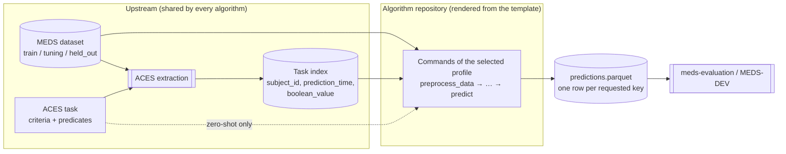

# MEDS algorithms

This site documents the `meds-algorithm` shared package and the
[MEDS algorithm template](https://github.com/McDermottHealthAI/MEDS_algorithm_template), a
[Copier](https://copier.readthedocs.io) template for packaging a clinical
prediction algorithm as a repository that anyone can run, compare, and audit the same way. You render a new
repository from it, implement your algorithm inside a fixed set of commands, and get, for free, the parts
that make algorithms comparable: a standard input and output, artifact manifests with measurements, MEDS-DEV
registration, a SLURM interface, and a staged test workflow ending in a full-data run.

!!! note "Who this site is for"
    Generated repositories' `README.md`, `AGENTS.md` and `SPEC.md` are written as instructions for coding
    agents that port algorithms. This site explains the same contract to people: algorithm implementers,
    reviewers, and benchmark organizers. The [specification](reference/spec.md) remains the normative
    source; where this site and the spec differ, the spec wins.

## The picture in one diagram



Everything left of the algorithm repository is built **once, upstream**: the dataset, the task definition,
and the cohort (which patients, at which prediction times, with which labels). Every algorithm receives the
same inputs and must return one prediction for every requested `(subject_id, prediction_time)`. That is
what makes results comparable.

## Fixed by the contract, owned by the algorithm

| Fixed by the contract | Owned by the algorithm |
|---|---|
| Inputs: a split-sharded MEDS dataset, a task index, optional dataset predicates, and (zero-shot) an ACES task | Preprocessing, featurization, tokenization |
| Six **algorithm profiles**, each a fixed sequence of commands | Architecture, framework, batching, hardware |
| Standard command arguments (`external_meds_dir`, `output_predictions_dir`, …) | Intermediate payload formats (checkpoints, embeddings, caches) |
| A `manifest.yaml` envelope on every artifact, written last and published with rollback | How the payload inside an artifact is laid out |
| Wall time and memory measurements on every command | How fast the algorithm is |
| Final predictions in the meds-evaluation schema, keyed and complete | How probabilities are computed |
| `algorithms/<profile>/model.yaml` for MEDS-DEV, SLURM scripts, GitHub result sync | The command strings inside them, once finalized |

The contract fixes **boundaries**, not methods. An algorithm can be a PyTorch transformer, a gradient-boosted
tree, an external executable or a call to a service; the template only cares that each command consumes
the right artifacts and publishes the right one.

## Where to go next

- **Find an implementation:** browse the [algorithm catalogue](implemented-algorithms.md).
- **Getting started:** read [Concepts](concepts.md), [Choosing a profile](profiles.md), then the
  [Workflow](workflow.md) from implementation to validation.
- **Building an algorithm:** prepare instructions with the [prompt builder](prompt-builder.md),
  learn the [run commands](running.md), or follow the [fully manual example](manual-example.md).
- **Development:** explore the [core package](core-package.md) and
  [what belongs in the template or shared package](shared-package-assessment.md). Use the
  [migration guide](migration-v4.md) and [publishing guide](releasing.md) when maintaining packages.
- **Reference:** consult the [specification](reference/spec.md),
  [tests and acceptance](testing.md), or [zero-shot guide](zero-shot.md) for the details.

## Preview this site locally

From a checkout of `McDermottHealthAI/meds-algorithm`:

```bash
uv sync --locked --group docs
uv run --group docs mkdocs serve
```
